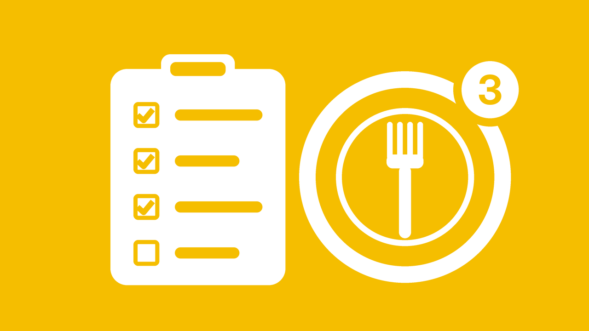
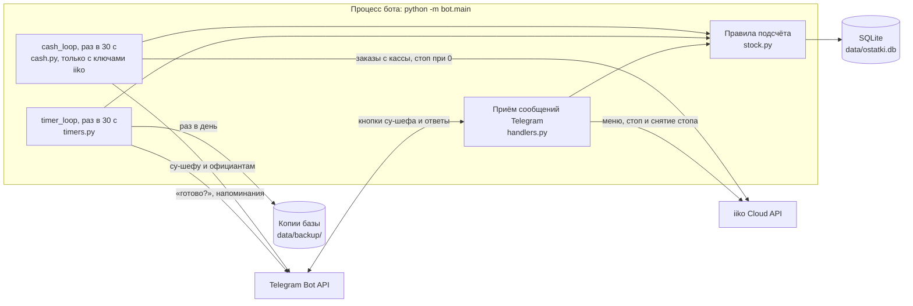

# Бот учёта остатков на кухне

Telegram-бот для су-шефа: следит за остатками порционных блюд, предупреждает, когда блюдо заканчивается, и сообщает официантам о стопе.



Логика работы утверждена в [docs/logika-bota.md](docs/logika-bota.md). Код пишется строго по этому файлу.

## Что уже умеет (шаги 1 и 2 из раздела 12)

- 📋 Остатки: список блюд, свободно / в работе, отметка стопа.
- ➕ Пополнить: выбрать блюдо, ввести количество. Пополнение снимает стоп.
- 🔄 Утренний пересчёт: бот спрашивает факт по каждому блюду и показывает расхождения.
- 🍽 Добавить блюдо в список контроля.
- Штучные весовые блюда (ребро телёнка и подобное): у каждого куска свой вес, пополнение строкой `550 620 480`, продажа и пересчёт по кускам.
- 🧾 Продажа (тест): пробить одну порцию руками, для проверки без кассы.
- Осталось 3 порции: одно предупреждение су-шефу.
- Стало 0: блюдо в стоп, официантам сразу «в стопе». Су-шефу вопрос «через сколько будет?» (1 / 2 / 3 часа), его ответ уходит официантам вторым сообщением.
- Су-шеф не ответил: через 15 минут одно напоминание, больше не беспокоит.
- По таймеру: «готово? Да / Нет». Да: сколько порций, блюдо выходит из стопа, официантам «снова в продаже».
- Пробили сверх остатка: срочно су-шефу и официантам, остаток не уходит ниже 0.
- Бот отвечает только су-шефу (его Telegram ID в настройках).

### Стоп в iiko

Если в `.env` вписаны три ключа iiko (`IIKO_API_KEY`, `IIKO_APP_ID`, `IIKO_CLIENT_SECRET`), бот сам ставит блюдо в стоп в iiko, когда остаток стал 0, и снимает стоп после пополнения. Су-шефу он только сообщает, получилось ли.

Блюдо бота связывается с меню iiko по точному названию, когда его добавляют или переименовывают (и при запуске бота для старых блюд). Если такого названия в iiko нет, бот так и скажет, а стоп в iiko для этого блюда придётся ставить вручную.

### Продажи с кассы iiko

С ключами iiko бот раз в 30 секунд сам читает заказы с кассы:
- позицию отправили на кухню: «свободно» −1, «в работе» +1;
- чек оплачен: «в работе» −1, «продано» +1;
- позицию удалили после кухни: бот спрашивает су-шефа «Вернуть в остаток» или «Списать» и показывает тип удаления и комментарий официанта.

Бот считает только блюда, связанные с меню iiko, и только заказы, отправленные на кухню после первого запуска бота с ключами. У весового блюда бот берёт из чека вес и снимает кусок с таким же весом; если такого нет, спрашивает су-шефа, какой кусок снять. Если касса выключена или iiko не отвечает больше 10 минут, бот один раз пишет су-шефу, но только с 11:00 до 23:00 по Москве (время в `bot/cash.py`).

Без ключей iiko бот работает как раньше: стоп в iiko ставят вручную, продажи вводят кнопкой «🧾 Продажа (тест)».

### Чат официантов

1. Добавьте бота в группу официантов.
2. Су-шеф пишет в этой группе `/chatid`, бот отвечает числом (у групп оно с минусом).
3. Впишите число в `.env`: `WAITERS_CHAT_ID=-100...` и перезапустите бота.

Если чат не настроен, бот работает, но говорит су-шефу, что официантам не написал.

## Как запустить

На Windows проще всего: заполнить `.env` (копия `.env.example`) и дважды кликнуть `zapusk.cmd`. Он сам перейдёт в папку проекта, поставит библиотеки и запустит бота.

Вручную:

```bash
python3 -m pip install -r requirements.txt
cp .env.example .env      # вписать BOT_TOKEN и SOUS_CHEF_ID (до 4 ID через запятую)
python3 -m bot.main
```

## Как проверить

```bash
python3 -m pytest
```

Тесты не ходят в интернет: Telegram в них заменён «фальшивой сессией».

## Файлы

| Файл | Что делает |
|---|---|
| `bot/db.py` | Создаёт базу SQLite: блюда, журнал, «сверх остатка», таймеры. Старую базу дополняет, данные не теряются |
| `bot/stock.py` | Правила подсчёта: добавить, пополнить, пересчитать, продать, таймеры |
| `bot/timers.py` | Раз в 30 секунд проверяет таймеры и спрашивает «готово?» |
| `bot/handlers.py` | Кнопки и диалоги су-шефа в Telegram |
| `bot/iiko.py` | Связь с iiko Cloud API: меню, поставить и снять стоп, заказы с кассы |
| `bot/cash.py` | Опрос кассы iiko раз в 30 секунд |
| `bot/config.py` | Читает токен и настройки из `.env` |
| `bot/backup.py` | Копия базы раз в день в `data/backup/`, хранит последние 14 |
| `bot/main.py` | Запуск бота |
| `deploy/ustanovka.sh` | Установка на сервер Ubuntu с автозапуском |
| `assets/welcome.png` | Картинка к приветствию на /start и /help |

## Как устроен бот

Один процесс Python (`python -m bot.main`) и один файл базы SQLite. Внутри процесса бот принимает сообщения Telegram (long polling, внешний адрес сервера не нужен) и крутит два фоновых цикла asyncio раз в 30 секунд: таймеры «готово?» с копией базы раз в день и опрос кассы iiko. Опрос кассы запускается, только если в `.env` есть ключи iiko. Отдельного сервера, очереди сообщений или другой базы нет.



## Установка на сервер (Ubuntu 24.04)

Бот работает только с облаком iiko и Telegram, поэтому сервер может быть где угодно. От root:

```bash
curl -fsSL https://raw.githubusercontent.com/Mahovplus/control_stock/main/deploy/ustanovka.sh | bash
nano /opt/control_stock/.env        # вписать ключи
systemctl restart ostatki-bot
```

Обновить бота: та же первая команда. Посмотреть, что с ботом: `systemctl status ostatki-bot` и `journalctl -u ostatki-bot -n 50`.
